<picture>
  <source media="(prefers-color-scheme: dark)" srcset="assets/banner-dark.svg" />
  <source media="(prefers-color-scheme: light)" srcset="assets/banner-light.svg" />
  
</picture>

I'm a **Software Engineer at Hare and Turtle AI Solutions**, working as a polyglot developer for **MSIG USA**, a large insurance group, and building software across its lines of business. I build web products end to end — from the interface people use every day to the API and database behind it. Outside work I run **[Nexora Studio](https://software-studio.nexoralab.workers.dev/)**, where small businesses get software that is fast, tested and theirs to run.

See my work, experience and resume at **[shubhamdsk.github.io/shubham-portfolio](https://shubhamdsk.github.io/shubham-portfolio/)**.

> **Now** &nbsp;·&nbsp; Polyglot developer for MSIG USA at Hare and Turtle AI Solutions &nbsp;·&nbsp; Shipping client products at Nexora Studio &nbsp;·&nbsp; Open to collaboration

## Selected work

  <a href="https://shubhamdsk.github.io/shubham-portfolio/"><picture><source media="(prefers-color-scheme: light)" srcset="assets/card-portfolio-light.svg" /></picture></a>
  <a href="https://software-studio.nexoralab.workers.dev/"><picture><source media="(prefers-color-scheme: light)" srcset="assets/card-nexora-light.svg" /></picture></a>
  <a href="https://github.com/shubhamdsk/cattle-feed-showcase"><picture><source media="(prefers-color-scheme: light)" srcset="assets/card-cattle-feed-light.svg" /></picture></a>
  <a href="https://github.com/shubhamdsk/vighnaharta-traders-showcase"><picture><source media="(prefers-color-scheme: light)" srcset="assets/card-vighnaharta-light.svg" /></picture></a>
  <a href="https://github.com/shubhamdsk/shree-balaji-showcase"><picture><source media="(prefers-color-scheme: light)" srcset="assets/card-shree-balaji-light.svg" /></picture></a>
  <a href="https://github.com/shubhamdsk/cricket-live"><picture><source media="(prefers-color-scheme: light)" srcset="assets/card-cricket-live-light.svg" /></picture></a>
  <a href="https://github.com/shubhamdsk/SQL-Automation-Next"><picture><source media="(prefers-color-scheme: light)" srcset="assets/card-sql-automation-light.svg" /></picture></a>

Live sites: [Portfolio](https://shubhamdsk.github.io/shubham-portfolio/) · [Nexora Studio](https://software-studio.nexoralab.workers.dev/) · [Shree Balaji Paints](https://shree-balaji.shreebalajipaints.workers.dev/) · [Cricket Live](https://cricket-live-shubhamdsk1.vercel.app/) · [Hotel Sarvottam](https://shubhamdsk.github.io/Hotel-Sarvottam/) · [More repositories →](https://github.com/shubhamdsk?tab=repositories)

## How I work

- **Interfaces that hold up under data.** Dashboards, large grids and multi-step forms in Angular and React.
- **The whole system, not just the screen.** ASP.NET Core and Next.js APIs, PostgreSQL, Redis, clean boundaries.
- **Edge-first and inexpensive to run.** Cloudflare Workers, Vercel and serverless Postgres.
- **Quality by default.** Strict TypeScript, unit and end-to-end tests, CI on every push, accessible markup.

## Toolkit

<picture><source media="(prefers-color-scheme: light)" srcset="assets/toolkit-light.svg" /></picture>

## Activity

<picture>
  <source media="(prefers-color-scheme: dark)" srcset="https://raw.githubusercontent.com/shubhamdsk/shubhamdsk/output/github-contribution-grid-snake-dark.svg" />
  <source media="(prefers-color-scheme: light)" srcset="https://raw.githubusercontent.com/shubhamdsk/shubhamdsk/output/github-contribution-grid-snake.svg" />
  
</picture>

**Have a product in mind?** [View my portfolio](https://shubhamdsk.github.io/shubham-portfolio/) · [Start a project](https://software-studio.nexoralab.workers.dev/) · [Connect on LinkedIn](https://www.linkedin.com/in/shubham-deshmukh1720)

